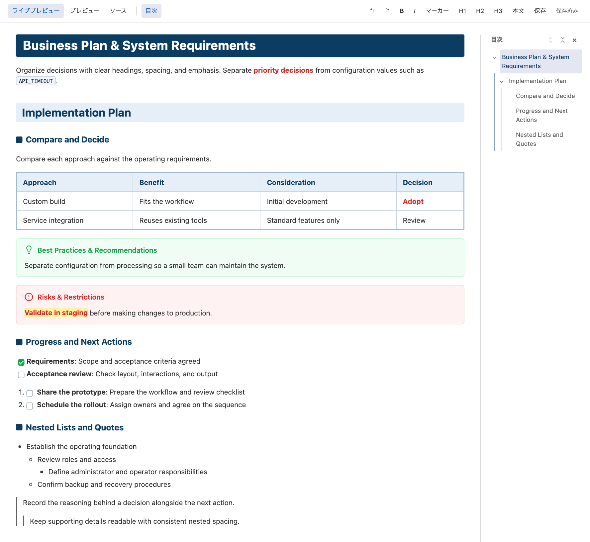
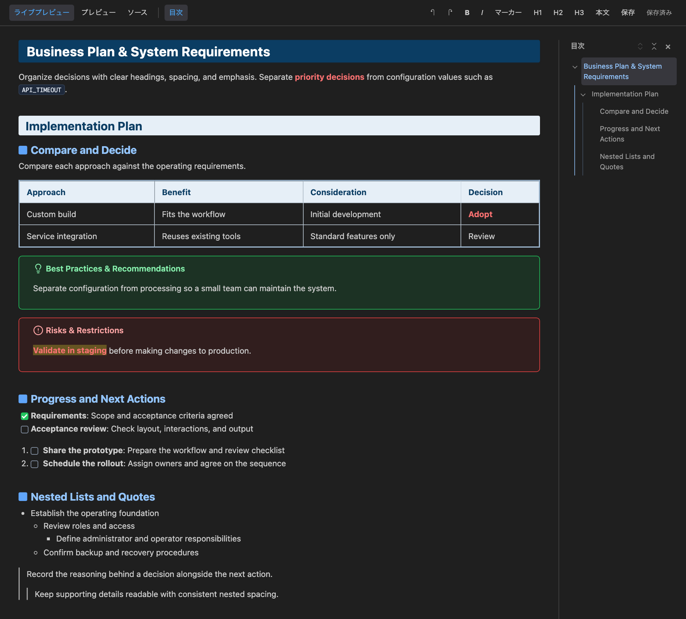
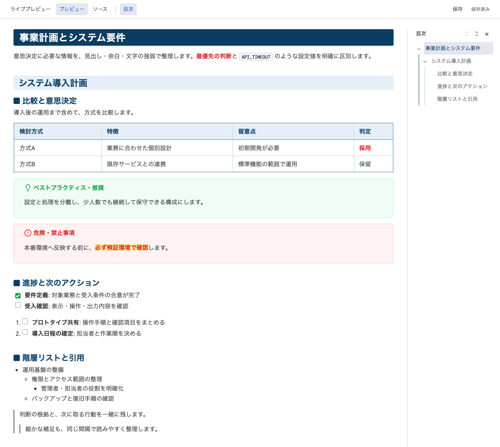
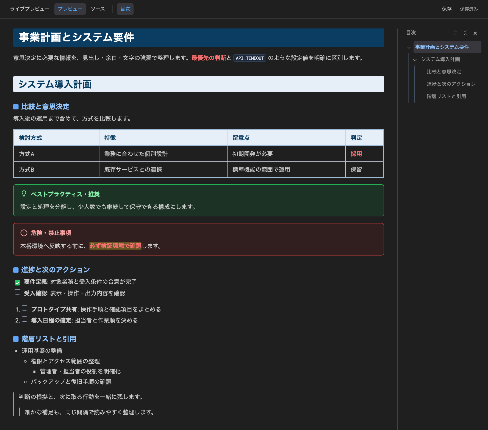
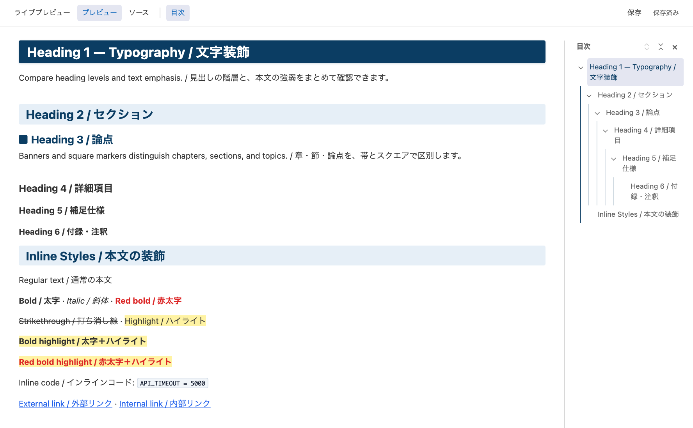
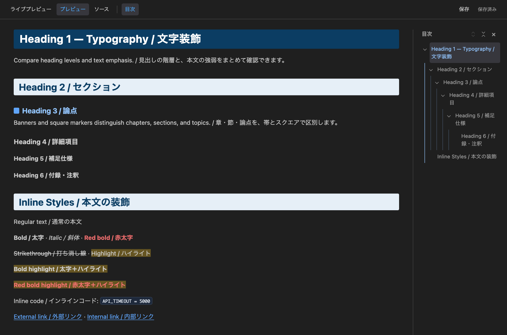
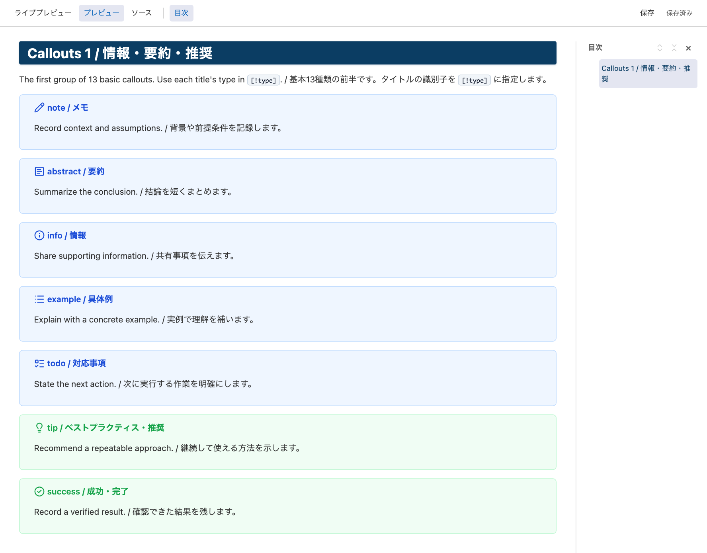
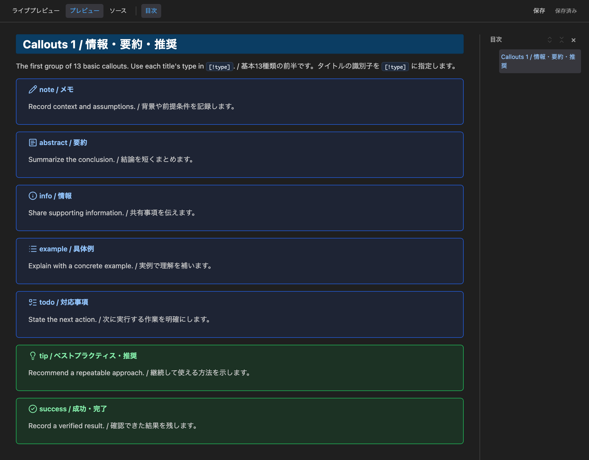
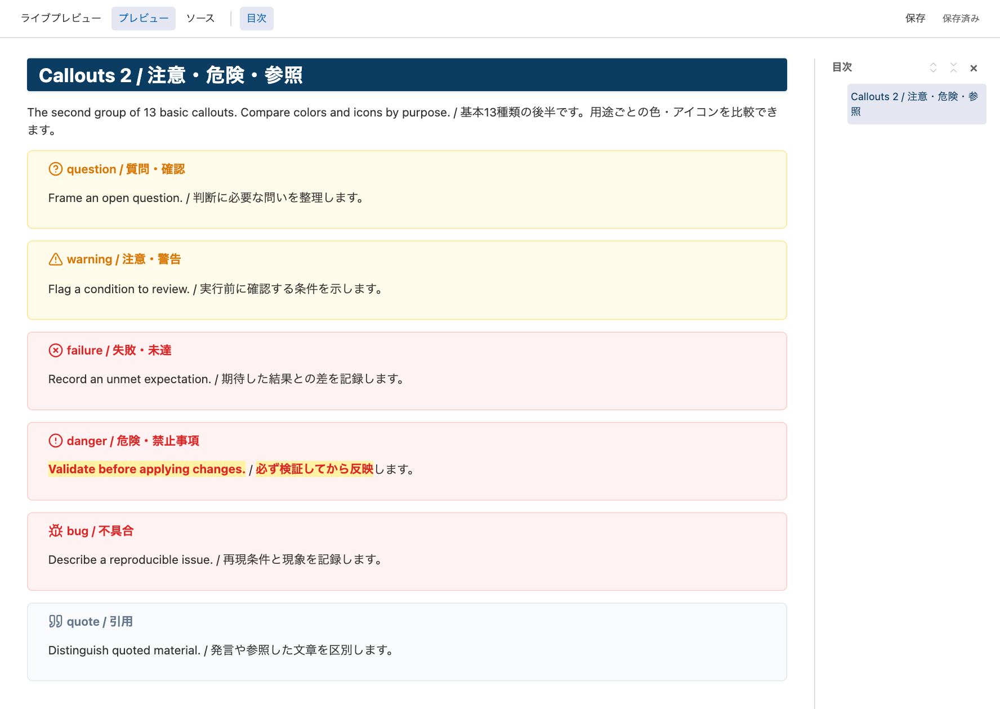
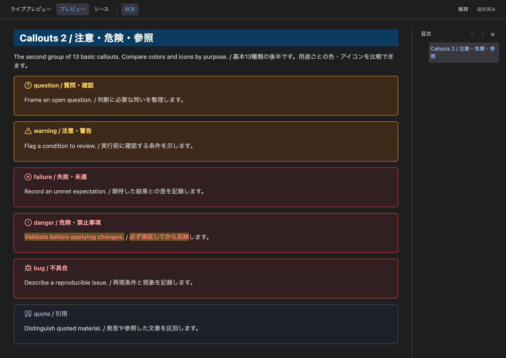

# Swak Markdown

## Overview / 概要

**English**

**Clear documents. Comfortable editing.**

Swak Markdown brings the typography and colors of the [Swak Obsidian theme](https://github.com/swak-inc/obsidian-theme-swak) to a Markdown editor. Edit the styled document directly, switch to reading view in the same tab, and navigate long documents with a collapsible, resizable outline.

For VS Code desktop and compatible editors, including Antigravity IDE. Light and dark appearances follow your editor theme. The current toolbar is in Japanese.

**日本語**

**読みやすい文書を、そのまま編集。**

Swak Markdownは、[SwakのObsidianテーマ](https://github.com/swak-inc/obsidian-theme-swak)の文字組みと配色を取り入れたMarkdownエディターです。整った表示のまま直接編集し、同じタブで閲覧へ切り替えられます。開閉・幅調整できる目次で、長い文書も扱いやすくなります。

VS Codeデスクトップ版とAntigravity IDEなどの互換エディター向けです。ライト・ダークはIDEのテーマに追従します。現在の操作バーは日本語表示です。

---

## Live Preview / ライブプレビュー

**English**

Edit headings, paragraphs, tables, lists, quotes, callouts, and text emphasis directly. Save, undo, and redo without leaving the document. Click a task checkbox to update its Markdown.

**日本語**

見出し・本文・表・リスト・引用・コールアウト・文字装飾を直接編集できます。保存・Undo・Redoも同じ画面で操作し、タスクのチェック状態はクリックで変更できます。

### Light / ライト



### Dark / ダーク



## Reading View & Outline / 閲覧と目次

**English**

Switch between **ライブプレビュー (Edit)** and **プレビュー (Read)** in the same tab while retaining your editing position and undo history. The built-in Markdown preview also receives Swak styling.

- **Heading hierarchy**: H1–H6 with blue indentation guides.
- **Collapse and expand**: Fold each branch or the entire outline.
- **Current position**: Follow scrolling and highlight the nearest active branch.
- **Resizable sidebar**: Drag the divider; double-click to reset.

Outline width and collapsed branches persist while switching views in the same tab. On narrow screens the outline opens as a floating panel. **ソース (Source)** opens the regular text editor in a separate tab.

**日本語**

**ライブプレビュー**（編集）と**プレビュー**（閲覧）を同じタブで切り替え、編集位置とUndo履歴を保持します。IDE標準のMarkdownプレビューにもSwakの装飾を適用します。

- **見出し階層**: H1〜H6の親子関係を青系のインデント線で表示します。
- **開閉**: 親見出しごと、または全体を展開・折りたたみできます。
- **現在位置**: スクロール位置と、操作中の階層を強調します。
- **幅の調整**: 境界線をドラッグして調整し、ダブルクリックで初期幅へ戻せます。

目次の幅と開閉状態は、同じタブ内の表示切替でも保持します。狭い画面では浮動パネルで表示します。**ソース**は、別タブの標準テキストエディターを開きます。

### Light / ライト



### Dark / ダーク



## Typography / 文字装飾

**English**

Navy H1 banners, pale blue H2 sections, and square H3 markers make the document structure visible. Compact lists, neutral quote borders, and aligned tables keep supporting details readable.

| Appearance | Markdown |
| --- | --- |
| Bold | `**text**` |
| Italic | `*text*` |
| Red bold | `***text***` |
| Highlight | `==text==` |
| Red bold with highlight | `==***text***==` |
| Strikethrough | `~~text~~` |

Swak displays combined bold and italic as red bold. For red bold with highlighting, place `***` inside `==`.

**日本語**

ネイビーのH1帯、淡青のH2、スクエア付きのH3で文書の構造を示します。コンパクトなリスト、グレー系の引用線、整った表組みで補足情報も読みやすく整理します。

| 表示 | Markdown |
| --- | --- |
| 太字 | `**text**` |
| 斜体 | `*text*` |
| 赤太字 | `***text***` |
| ハイライト | `==text==` |
| 赤太字＋ハイライト | `==***text***==` |
| 打ち消し線 | `~~text~~` |

Swakでは太字＋斜体の組み合わせを赤太字で表示します。赤太字＋ハイライトは、`==` の内側に `***` を置きます。

### Light / ライト



### Dark / ダーク



## Callouts / コールアウト

**English**

Use Obsidian-style callouts to organize information. Nested callouts and initially expanded (`[!type]+`) or collapsed (`[!type]-`) sections are supported.

```markdown
> [!tip] Recommendation
> Keep related decisions together.
```

| Color | Purpose | Types |
| --- | --- | --- |
| Blue | Information and tasks | `note`, `abstract`, `info`, `example`, `todo` |
| Green | Recommendations and success | `tip`, `success` |
| Yellow | Questions and caution | `question`, `warning` |
| Red | Risks and failures | `failure`, `danger`, `bug` |
| Gray | Quotations | `quote` |

**日本語**

Obsidian形式のコールアウトで情報を整理できます。ネストと、初期展開（`[!type]+`）・初期折りたたみ（`[!type]-`）に対応します。

```markdown
> [!tip] 推奨
> 関連する決定事項をまとめます。
```

| 色 | 用途 | 種類 |
| --- | --- | --- |
| 青 | 情報・作業 | `note`, `abstract`, `info`, `example`, `todo` |
| 緑 | 推奨・成功 | `tip`, `success` |
| 黄 | 確認・注意 | `question`, `warning` |
| 赤 | 危険・失敗 | `failure`, `danger`, `bug` |
| グレー | 引用 | `quote` |

### Information & Recommendations / 情報・推奨





### Questions, Risks & Quotes / 確認・危険・引用





**English**

Images show the extension's actual webview with the repository's public sample documents, rendered in Chromium with IDE theme colors. [Capture details](DEVELOPMENT.md#screenshots--スクリーンショット).

**日本語**

画像は、公開サンプルを拡張本体のWebviewで表示し、IDEのテーマ色を設定したChromiumで撮影しています。[撮影方法](DEVELOPMENT.md#screenshots--スクリーンショット)。

## Get Started / 使い方

**English**

1. [ ] **Install**: Install **Swak Markdown** by **Swak Inc.** from the [Visual Studio Marketplace](https://marketplace.visualstudio.com/items?itemName=swak-inc.swak-markdown-preview). For a downloaded `.vsix`, run **Extensions: Install from VSIX** in the command palette.
2. [ ] **Open**: Open a `.md` or `.markdown` file.
3. [ ] **Edit**: Run **Swak: ライブプレビューで編集**, or select the pencil icon in the editor toolbar.
4. [ ] **Read**: Switch views using the top toolbar. The book icon opens **Swak: プレビューで読む**.

| Action | Shortcut |
| --- | --- |
| Save | `Cmd+S` on macOS; `Ctrl+S` on Windows/Linux |
| Undo | `Cmd+Z` / `Ctrl+Z` |
| Redo | `Cmd+Shift+Z` / `Ctrl+Shift+Z` |
| Table cell navigation | `Tab` / `Shift+Tab` |
| Resize focused outline divider | `←` / `→`; `Enter` resets |

**日本語**

1. [ ] **導入**: [Visual Studio Marketplace](https://marketplace.visualstudio.com/items?itemName=swak-inc.swak-markdown-preview)から、発行者が **Swak Inc.** の **Swak Markdown** をインストールします。配布用 `.vsix` を使う場合は、コマンドパレットの **Extensions: Install from VSIX** を実行します。
2. [ ] **開く**: `.md` または `.markdown` ファイルを開きます。
3. [ ] **編集**: **Swak: ライブプレビューで編集**を実行するか、エディター右上の鉛筆アイコンを選びます。
4. [ ] **閲覧**: 上部のボタンで表示を切り替えます。本のアイコンからは **Swak: プレビューで読む**を開けます。

| 操作 | キー |
| --- | --- |
| 保存 | macOSは `Cmd+S`、Windows/Linuxは `Ctrl+S` |
| 元に戻す | `Cmd+Z` / `Ctrl+Z` |
| やり直す | `Cmd+Shift+Z` / `Ctrl+Shift+Z` |
| 表のセル移動 | `Tab` / `Shift+Tab` |
| フォーカス中の目次境界の幅調整 | `←` / `→`、`Enter` で初期幅へ戻す |

### Default Editor / 既定のエディター

**English**

Add these entries to your existing `workbench.editorAssociations` setting. Keep associations for other file types.

To prevent a formatter from rewriting the whole document on save, set `editor.formatOnSave` to `false` within your existing `[markdown]` settings. Whole-document formatting or external changes rebuild live-preview undo history.

**日本語**

既存の `workbench.editorAssociations` に次の項目を追加します。他の拡張子の設定は保持してください。

保存時の自動整形による全文変更を避けるには、既存の `[markdown]` 設定内で `editor.formatOnSave` を `false` にします。全文整形や外部からの変更が入ると、ライブプレビューのUndo履歴は再構築されます。

```json
"workbench.editorAssociations": {
  "*.md": "swak.markdown.live",
  "*.markdown": "swak.markdown.live"
}
```

### Restore / 元に戻す

**English**

Set the associations above to `default`, or remove the entries, to use the regular text editor again. Disable Swak Markdown to remove its preview styling. Remove your Markdown-specific `editor.formatOnSave` override to inherit your previous formatter settings.

**日本語**

上記の関連付けを `default` に変更するか削除すると、通常のテキストエディターに戻せます。プレビューの装飾も外す場合はSwak Markdownを無効化します。追加したMarkdown用の `editor.formatOnSave` 設定を削除すれば、従来の自動整形設定を継承します。

## Compatibility & Limits / 対応範囲と制約

**English**

| Content | Live editing | Reading view |
| --- | --- | --- |
| Headings, tables, lists, quotes, emphasis | Editable | Rendered |
| Callouts and task lists | Editable; titles use Markdown text | Rendered |
| Math | Preserved as source; edit in Source | Rendered with KaTeX |
| HTML and YAML | Preserved as source; edit in Source | HTML is sanitized; YAML has no property editor |
| Wiki links and note embeds | Preserved as source | No Obsidian vault resolution |
| Mermaid | Editable code block | Code block; no diagram rendering |

Files remain ordinary Markdown. Edited blocks may be normalized; untouched blocks retain their original syntax and blank lines. If another editor changes the same file during an edit, conflicting input is recovered in a separate unsaved tab.

This is a separate editor, not the Obsidian editing engine. It does not change the IDE's overall theme or its source editor. [Development and verification](DEVELOPMENT.md).

**日本語**

| 内容 | ライブ編集 | 閲覧 |
| --- | --- | --- |
| 見出し・表・リスト・引用・装飾 | 編集可能 | 表示 |
| コールアウト・タスク | 編集可能・タイトルはMarkdown記法 | 表示 |
| 数式 | 記法を保持・ソースで編集 | KaTeXで表示 |
| HTMLとYAML | 記法を保持・ソースで編集 | HTMLを安全化して表示・YAMLのプロパティ画面なし |
| Wikiリンク・ノート埋め込み | 記法を保持 | Obsidian保管庫のリンク解決なし |
| Mermaid | コードとして編集 | コード表示・図への変換なし |

ファイルは通常のMarkdownのままです。変更したブロックの記法は整形される場合がありますが、未変更のブロックは元の記法と空行を保ちます。同時編集が競合した場合は、入力を未保存の別タブに退避します。

Obsidianとは別の編集エンジンです。IDE全体のテーマやソースエディターの配色は変更しません。[開発と検証](DEVELOPMENT.md)。

## Privacy & Support / データの扱いとサポート

**English**

Swak Markdown has no document-upload service or usage telemetry. It edits files in the workspace selected in your IDE. External images can make HTTPS requests to their hosts, which can receive the requested URL and connection information such as your IP address. HTML form submission is disabled in Swak's custom editor. The IDE and other extensions have their own data-handling policies.

For bugs and feature requests, use [GitHub Issues](https://github.com/swak-inc/vscode-swak-markdown/issues). Include **Swak Markdown**, the extension and editor versions, reproduction steps, and a small sample with private information removed. See [Support](SUPPORT.md) and [Changelog](CHANGELOG.md).

**日本語**

Swak Markdownは文書のアップロード機能や利用状況の収集機能を持ちません。IDEで選択したワークスペース内のファイルを編集します。外部画像はHTTPSで取得される場合があり、配信元へ画像URLやIPアドレスなどの接続情報が伝わります。SwakのカスタムエディターではHTMLフォームの送信を禁止しています。IDE本体や他の拡張機能によるデータの扱いは、それぞれの方針に従います。

不具合や要望は[GitHub Issues](https://github.com/swak-inc/vscode-swak-markdown/issues)へ。**Swak Markdown**と明記し、拡張・エディターのバージョン、再現手順、非公開情報を除いた最小サンプルを添えてください。[サポート](SUPPORT.md)・[変更履歴](CHANGELOG.md)。

## License & Author / ライセンス・開発元

**English**

[MIT License](LICENSE). Bundled dependencies retain their own licenses, included in `dist/THIRD-PARTY-NOTICES.txt` in the package.

Developed by [Swak Inc.](https://swak.jp/).

**日本語**

[MITライセンス](LICENSE)で配布しています。同梱ライブラリのライセンスは、パッケージ内の `dist/THIRD-PARTY-NOTICES.txt` に記載しています。

開発元：[株式会社Swak](https://swak.jp/)。
