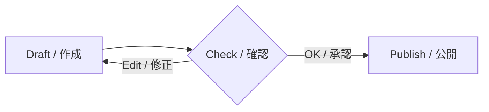
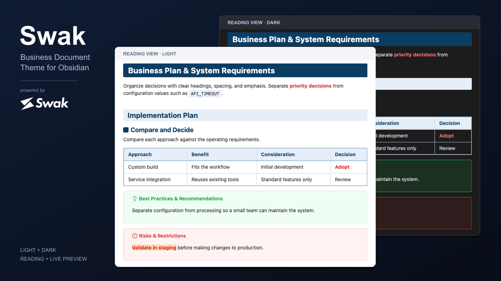

<!-- showcase: typography -->

# Heading 1 — Typography / 文字装飾

Compare heading levels and text emphasis. / 見出しの階層と、本文の強弱をまとめて確認できます。

## Heading 2 / セクション

### Heading 3 / 論点

Banners and square markers distinguish chapters, sections, and topics. / 章・節・論点を、帯とスクエアで区別します。

#### Heading 4 / 詳細項目

##### Heading 5 / 補足仕様

###### Heading 6 / 付録・注釈

## Inline Styles / 本文の装飾

Regular text / 通常の本文

**Bold / 太字** · *Italic / 斜体* · ***Red bold / 赤太字***

~~Strikethrough / 打ち消し線~~ · ==Highlight / ハイライト==

==**Bold highlight / 太字＋ハイライト**==

==***Red bold highlight / 赤太字＋ハイライト***==

Inline code / インラインコード: `API_TIMEOUT = 5000`

[External link / 外部リンク](https://swak.jp) · [Internal link / 内部リンク](ui-sample-ja.md)

A footnote adds context. / 脚注で補足を添えます。[^reference]

---

A horizontal rule separates topics. / 水平線で話題を区切ります。

[^reference]: Supporting information appears at the end. / 補足情報は本文末尾にまとめます。

<!-- showcase: structure -->

# Structure / 表・リスト・引用

Examples of column alignment, nested items, and progress tracking. / 列の整列、項目の階層、進捗を整理するための表示例です。

## Table / 表組み

| Item / 項目 | Status / 状態 | Count / 件数 |
| :--- | :---: | ---: |
| Requirements / 要件 | **Agreed / 合意** | 12 |
| Validation / 検証 | ***Priority / 優先*** | 3 |
| Release / 公開 | ==Planned / 予定== | 1 |

## Lists / 階層リスト

- Unordered item / 箇条書き
  - Nested item / 第2階層
    - Deeper item / 第3階層
- Next item / 次の項目

1. Ordered item / 番号リスト
   1. Nested step / 子の手順
      - Supporting bullet / 補足の箇条書き
2. Next step / 次の手順

### Tasks / チェックボックス

- [x] **Requirements / 要件**: Agreed / 合意済み
- [ ] **Layout / 表示**: To review / 確認待ち

1. [x] **Prepare / 準備**: Complete / 完了
2. [ ] **Validate / 検証**: Check the rendered view / 実画面を確認

## Quotes / 引用のネスト

> Decision context / 判断の根拠
>> Supporting information / 補足する情報
>>> Detailed conditions / 詳細な条件

<!-- showcase: callouts-information -->

# Callouts 1 / 情報・要約・推奨

The first group of 13 basic callouts. Use each title's type in `[!type]`. / 基本13種類の前半です。タイトルの識別子を `[!type]` に指定します。

> [!note] note / メモ
> Record context and assumptions. / 背景や前提条件を記録します。

> [!abstract] abstract / 要約
> Summarize the conclusion. / 結論を短くまとめます。

> [!info] info / 情報
> Share supporting information. / 共有事項を伝えます。

> [!example] example / 具体例
> Explain with a concrete example. / 実例で理解を補います。

> [!todo] todo / 対応事項
> State the next action. / 次に実行する作業を明確にします。

> [!tip] tip / ベストプラクティス・推奨
> Recommend a repeatable approach. / 継続して使える方法を示します。

> [!success] success / 成功・完了
> Record a verified result. / 確認できた結果を残します。

<!-- showcase: callouts-attention -->

# Callouts 2 / 注意・危険・参照

The second group of 13 basic callouts. Compare colors and icons by purpose. / 基本13種類の後半です。用途ごとの色・アイコンを比較できます。

> [!question] question / 質問・確認
> Frame an open question. / 判断に必要な問いを整理します。

> [!warning] warning / 注意・警告
> Flag a condition to review. / 実行前に確認する条件を示します。

> [!failure] failure / 失敗・未達
> Record an unmet expectation. / 期待した結果との差を記録します。

> [!danger] danger / 危険・禁止事項
> ==***Validate before applying changes.***== / ==***必ず検証してから反映***==します。

> [!bug] bug / 不具合
> Describe a reproducible issue. / 再現条件と現象を記録します。

> [!quote] quote / 引用
> Distinguish quoted material. / 発言や参照した文章を区別します。

<!-- showcase: callouts-layout -->

# Callout Layout / 折りたたみ・ネスト

Title-only, expanded, collapsed, and nested callouts. / 本文なし、展開・折りたたみ、複数階層の組み合わせです。

> [!tip] Title only / 本文なし

> [!info]+ Expanded by default / 初期状態で展開
> Start with the body visible. / `[!info]+` で開いた状態から始めます。

> [!question]- Collapsed by default / 初期状態で折りたたみ
> Reveal this body on demand. / `[!question]-` で閉じた状態から始めます。

> [!note] Parent callout / 親のコールアウト
> Group related information. / ひとつの論点に関連情報をまとめます。
>
>> [!tip] Nested recommendation / 子のコールアウト
>> State the recommended action. / 推奨する対応を示します。
>>
>>> [!example] Third level / 第3階層
>>> Add a concrete example. / 具体例を添えます。

> [!todo] Callout with tasks / タスクを含むコールアウト
> - [x] **Prepare / 準備**: Complete / 完了
> - [ ] **Review / 確認**: Check the layout / 表示を確認

<!-- showcase: code-diagrams -->

# Code & Diagrams / コード・図・数式

Show configuration, workflows, and calculations. / 設定、処理の流れ、計算を文書に組み込みます。

## Code / コードブロック

```javascript
const settings = {
  environment: "staging",
  timeout: 5000,
};

function isReady(status) {
  return status === "approved";
}
```

## Mermaid / フロー図



## Math / インライン・ブロック数式

Inline / インライン: $r = a / t$、$E = mc^2$

$$
\text{Achievement / 達成率} = \frac{\text{Actual / 実績}}{\text{Target / 目標}} \times 100
$$

<!-- showcase: details-embeds -->

# Details & Embeds / 折りたたみ・埋め込み

Examples of supporting details, images, and embedded notes. / 補足の表示と、画像・ノートの参照例です。

## Details / HTMLの折りたたみ

<details>
<summary>Collapsed details / 閉じた状態</summary>
<p>Reveal supporting information on demand. / 必要なときに補足を開けます。</p>
</details>

<details open>
<summary>Expanded details / 開いた状態</summary>
<p><strong>Review / 確認項目:</strong> Validate input, calculations, output, and recovery procedures. / 入力・計算・出力・復旧の各手順を確認します。</p>
</details>

## Image / 画像



## Note Embed / ノートの埋め込み

![[ui-embed-sample#Nested Lists and Quotes / 階層リストと引用]]
